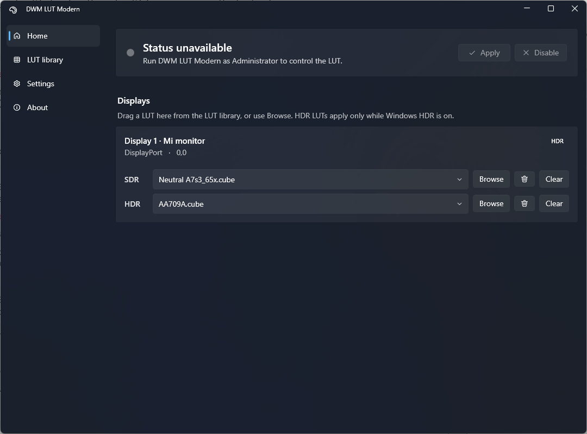

# DWM LUT Modern

System-wide 3D LUT correction for modern Windows 10/11 SDR/HDR workflows.

This is a maintained Windows 11 fork of [`lauralex/dwm_lut`](https://github.com/lauralex/dwm_lut), built from the practical 25H2 work in [`zkippp/dwm_lut_fixed`](https://github.com/zkippp/dwm_lut_fixed) and extended with profile-driven DWM symbol selection for current Windows releases.

## Why This Exists

DWM LUT applies 3D LUTs to the Windows desktop by hooking into DWM. That is useful when a display lacks hardware LUT calibration but you still want a practical system-wide calibration path:

Colorimeter -> DisplayCAL/ArgyllCMS -> 3D LUT -> DWM LUT -> Windows desktop correction.

Windows DWM internals are private and change across Windows updates. This fork treats compatibility as an engineering process: public-symbol profiles, logged hook selection, reproducible packages, and explicit compatibility notes.



## Current Compatibility

| Windows build | Channel | Status |
| ---: | --- | --- |
| `19045.7417` | Windows 10 22H2 | Fallback engine, exact profile pending |
| `26100.4946` | Windows 11 24H2 | Verified for normal windowed use on the reported AMD laptop; fullscreen issue open |
| `26200.8655` | Current test machine | Built |
| `26200.8737` | Windows 11 25H2 Stable Preview | Built, needs live validation |
| `26220.8754` | Windows Insider Beta 25H2 | Built, DWM payload alias with `26300.8758` |
| `26300.8758` | Windows Insider Experimental 26H2 | Built through exact DWM payload alias |
| `28000.2340` | Published Windows 11 26H1 | Built |
| `28020.2366` | Windows Insider Beta 26H1 | Built |
| `28120.2374` | Windows Insider Experimental 26H1 | Built through exact DWM payload alias |
| `29617.1000` | Canary / Future Platforms | Built, experimental |

See [docs/compatibility-matrix.md](docs/compatibility-matrix.md) for the full matrix and source evidence.
See [docs/build-catalog.md](docs/build-catalog.md) for the amd64/ARM64 build catalog and support status.
See [docs/universal-build-strategy.md](docs/universal-build-strategy.md) for why this is a multi-profile x64 build, not a magic single binary for every future DWM.
See [docs/engineering/fix-all-technical-guide.md](docs/engineering/fix-all-technical-guide.md) for the current maintainer-level porting, logging, Canary, HDR, and multi-monitor guide.
See [docs/research/legacy-universal-support.md](docs/research/legacy-universal-support.md) for the Windows 10 through Canary auto-detection plan based on old GitHub forks and diffs.
See [docs/validation-lab.md](docs/validation-lab.md) for what automated tests, Windows Sandbox,
Hyper-V, physical HDR/multi-monitor systems, and colorimeters can each prove.
See [docs/architecture-review-v5.md](docs/architecture-review-v5.md) for fixed risks and the v6
broker/health/identity roadmap.
See [docs/version-history.md](docs/version-history.md) for the truthful v1-v5 source provenance map.

## Download / Local Packages

**AMD / Windows 11 24H2 hotfix:** [Download the x64 portable preview](https://github.com/ArsenyPetukhov/dwm_lut_modern/releases/tag/v5.0.1-amd24h2-preview) for the blank screen and missing LUT reported on build `26100.4946`.

**Fullscreen windowed playback:** [Download the fullscreen preview](https://github.com/ArsenyPetukhov/dwm_lut_modern/releases/tag/v5.0.3-fullscreen-preview) for the same Windows build. This includes fullscreen transition and SDR/HDR switching fixes. Exclusive fullscreen remains outside DWM correction.

The primary v5 self-contained x64 app is staged here:

```text
dist\DwmLutModern-x64-portable-selfcontained\DwmLutModern.exe
```

The matching portable ZIP and installer are:

```text
dist\DwmLutModern-x64-portable-selfcontained.zip
dist\installer\DwmLutModern-Setup-x64.msi
```

The portable folder is self-contained but not single-file; keep the entire folder together. The
legacy `DwmLutGUI` packages remain available as a rollback until v5 completes exact-build live
validation.

If the portable app is running from the primary output folder during packaging, Windows locks its
framework files. The packager writes the current folder side-by-side with a `-next` suffix while
still refreshing the canonical ZIP and building the MSI from that current payload.

Per-build matrix artifacts are staged under:

`artifacts/packages/build-matrix`

Each per-build zip contains:

- `DwmLutGUI.exe`
- `dwm_lut.dll`
- profile table
- PDBs for diagnostics
- `README_INSTALL.md`

## Quick Start

1. Extract the v5 portable ZIP or install the MSI.
2. Run `DwmLutModern.exe` and accept the administrator prompt.
3. Assign an SDR `.cube` LUT, and optionally an HDR `.cube` LUT.
4. Leave Compatibility on `Auto-detect (recommended)` unless testing a specific Windows build family.
5. Click Apply.
6. Check `%SystemRoot%\Temp\dwm_lut.log`.
7. Click Disable before changing package files or LUT files.

## Logging

The DLL writes timestamped diagnostic logs to:

`%SystemRoot%\Temp\dwm_lut.log`

The GUI stages monitor metadata as `manifest.tsv` and compatibility selection as `resolver.cfg` during injection. The DLL copies the useful parts into the log before the GUI removes the staging folder.

## Building

```powershell
.\scripts\build-release.ps1 -Platform x64
```

Packaging:

```powershell
.\scripts\package-modern-app.ps1 -Platform x64 -SelfContained
.\scripts\package-modern-installer.ps1
```

Programmatic checks:

```powershell
.\scripts\test-build.ps1
```

UI render gate and validation tooling:

```powershell
.\scripts\capture-modern-ui.ps1
.\scripts\validation\New-DiagnosticLuts.ps1
.\scripts\validation\Start-WindowsSandboxValidation.ps1
.\scripts\validation\Collect-ValidationEvidence.ps1
```

Refresh the public amd64/ARM64 build catalog:

```powershell
.\scripts\update-build-catalog.ps1
```

Refresh mirrored legacy GitHub references and generated research manifests:

```powershell
.\scripts\update-legacy-references.ps1 -IncludeForks
```

See [BUILDING.md](BUILDING.md) for the full local build and package flow.

## Compatibility Feedback

If correction does not apply or behaves incorrectly on your Windows build, disable it and
[report a compatibility issue](https://github.com/ArsenyPetukhov/dwm_lut_modern/issues/new?template=compatibility_report.yml).
Technical safeguards and recovery details remain documented in [SECURITY.md](SECURITY.md) and
[docs/known-issues.md](docs/known-issues.md).

## Credits

Original project: [`lauralex/dwm_lut`](https://github.com/lauralex/dwm_lut)  
25H2 fork base: [`zkippp/dwm_lut_fixed`](https://github.com/zkippp/dwm_lut_fixed)

This repository keeps the GPL-3.0 license and upstream attribution intact.
