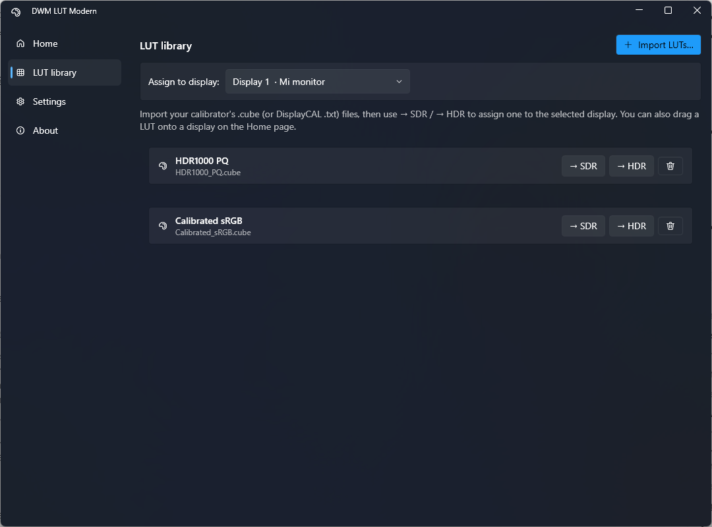
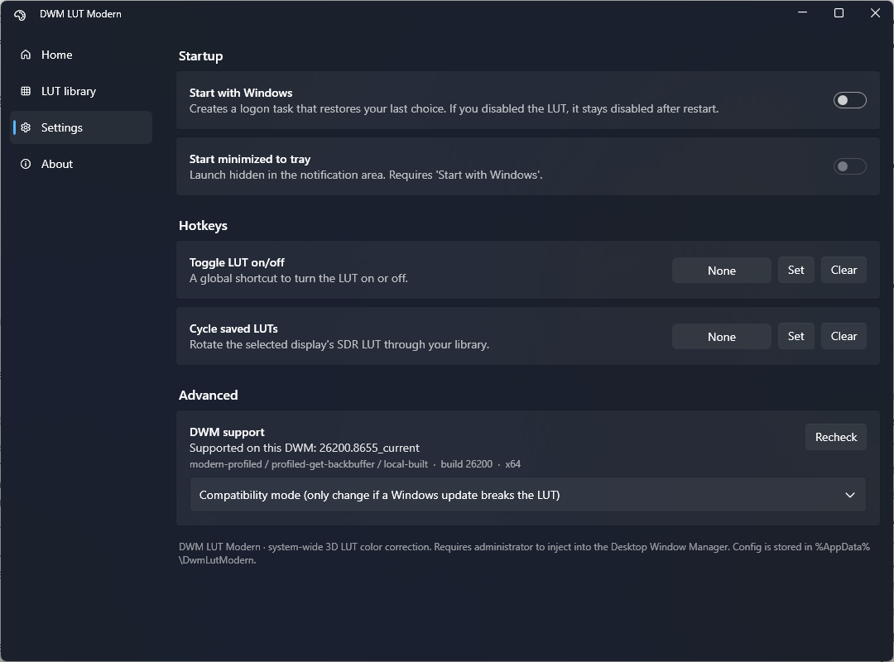
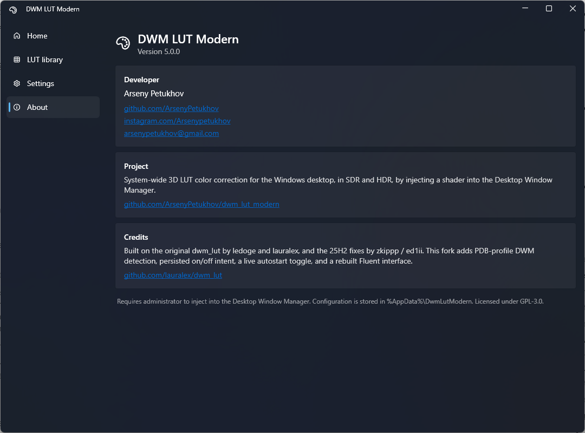

# DWM LUT Modern — User Guide

System-wide 3D LUT color correction for the Windows 11 desktop, in SDR **and** HDR. Point it at
the `.cube` file from your calibrator and it applies that correction to everything on screen by
injecting a shader into the Desktop Window Manager.

Developer: **Arseny Petukhov** — [GitHub](https://github.com/ArsenyPetukhov) ·
[Instagram](https://instagram.com/Arsenypetukhov) · arsenypetukhov@gmail.com
Project: https://github.com/ArsenyPetukhov/dwm_lut_modern

---

## Install & run

1. Get the portable folder `DwmLutModern-portable-selfcontained` (or the matching `.zip`) from
   `dist\`. It bundles the .NET runtime — **no install needed**.
2. Double-click **`DwmLutModern.exe`**. Accept the single UAC prompt (it needs admin to inject
   into DWM). You can copy the whole folder anywhere — USB stick, another PC — and it just runs.

On first launch a short wizard walks you through picking your SDR and HDR LUTs and offering to
start with Windows.

---

## Home — apply, disable, and per-display LUTs


- The big banner shows whether the LUT is **active** or **disabled**, with **Apply** and **Disable**.
- One card per connected display shows its name, connector, position, and an **SDR** and **HDR**
  slot. Each slot is a **dropdown of the LUTs you've used on that display** — switch between them
  instantly. Use **Browse** to add a new one, the trash icon to drop one from the list, or **Clear**
  to turn that slot off. You can also drag a LUT from the LUT library onto the card.
- A hotkey (Settings) can **cycle** the selected display's SDR dropdown through its saved LUTs.
- Each card shows an **SDR/HDR badge** for the display's current mode. If a display is in **HDR**
  but has no HDR LUT, a warning appears — because Windows uses the **HDR-slot** LUT while HDR is on,
  so an SDR-only assignment does nothing there. Assign an HDR LUT to fix it.

> Tip: SDR and HDR are separate slots on purpose. In HDR mode only the HDR LUT is used; in SDR mode
> only the SDR LUT is used. Assign both if you switch HDR on and off.

---

## LUT library — import once, assign anywhere



- **Import LUTs…** adds your `.cube`/`.txt` files to a reusable library.
- Pick a target in **Assign to display**, then click **→ SDR** or **→ HDR** on any LUT to assign it
  to that display's slot. You can also **drag** a LUT card onto a display on the Home page.

---

## Settings — startup, hotkeys, compatibility



- **Start with Windows** — a live toggle that creates/removes a logon task. It restores your last
  choice: if you disabled the LUT, it stays disabled after restart. (Also on the tray menu.)
- **Start minimized to tray** — launches hidden; enabled only when Start-with-Windows is on.
- **Hotkeys** — set a global shortcut to toggle the LUT on/off, or to cycle the selected display's
  SDR LUT through your library.
- **Advanced → DWM support** shows whether your current Windows build has a verified profile.
  **Compatibility mode** stays on *Auto* unless a Windows update breaks the LUT and you need to
  force a specific engine.

---

## About



Developer credit, project and upstream links, version, and where config lives. **Check for
updates** queries the GitHub repo for a newer release and offers to open the downloads page.

---

## Tray

Closing the window hides it to the notification area. Right-click the tray icon for **Apply**,
**Disable**, a checkable **Start with Windows**, **Open**, **Disable and exit**, and **Exit**. The
icon tooltip reflects whether the LUT is on.

---

## The sleep / reboot behavior (the important fix)

The app remembers whether you left the LUT **on or off** and honors that everywhere:

- Disable it, then reboot or wake from sleep → it **stays off**. It will not silently come back.
- Enable it, then reboot or wake → it's **restored automatically**.
- If the LUT was on and **DWM restarts** (a driver reset, a crash, or restarting Explorer drops
  the injected shader), a background watchdog notices within a couple of seconds and **re-applies
  it** — but only because you left it on. It never re-applies a LUT you disabled.

This intent lives in `%AppData%\DwmLutModern\state.json`, so it survives moving or updating the app.

---

## Command line (optional)

The exe accepts documented flags (also used by the autostart task):

```
DwmLutModern.exe --status         # print current status as JSON
DwmLutModern.exe --apply          # turn the LUT on (remembers intent)
DwmLutModern.exe --disable        # turn it off (remembers intent)
DwmLutModern.exe --toggle
DwmLutModern.exe --startup        # restore saved intent (used at logon)
DwmLutModern.exe --apply-monitor 1 --sdr "C:\path\to.cube" --hdr "C:\path\hdr.cube"
DwmLutModern.exe --minimized --exit
DwmLutModern.exe --help
```

---

## Troubleshooting

- **Nothing changes on screen** — make sure a LUT is assigned to the slot matching the display's
  current mode (HDR LUT for HDR, SDR LUT for SDR), then Apply.
- **A calibration LUT looks blown-out** — that's a *creative/camera* LUT, not a display-calibration
  LUT. Use a `.cube`/`.txt` generated by DisplayCAL/ArgyllCMS for your monitor.
- **App won't start** — it writes `%AppData%\DwmLutModern\crash.log` and shows a message. DWM-side
  diagnostics are at `%SystemRoot%\Temp\dwm_lut.log`.
- **Compatibility after a Windows update** — Settings → Advanced → Compatibility mode; try the entry
  matching your build, or check DWM support status.
